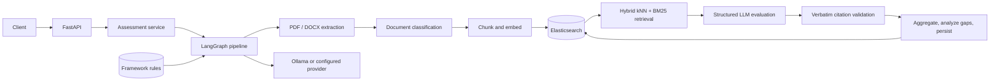

# Compliance Evaluator

A locally runnable compliance-policy evaluation platform. Upload
policy PDFs or DOCX files, and the system evaluates them against a matrix of atomic
compliance rules (SOC 2–style) using hybrid Elasticsearch retrieval and a
locally hosted LLM — producing binary verdicts anchored to **verbatim source
citations**, with AI-generated gap analysis for every gap.

No OpenAI dependency. Everything runs on your machine: FastAPI + LangGraph +
Elasticsearch 8 + Ollama.

## Architecture

```
PDFs ──► extract (PyMuPDF) ──► classify ──► chunk ──► embed ──► ES index
                                                                 │
rules (ES) ──► per rule: hybrid retrieve (kNN+BM25) ──► LLM evaluate
                                                                 │
                        citation validation ◄── verbatim check ◄──┘
                                 │
                    aggregate ──► gap analysis ──► report ──► persist (ES)
```

Orchestrated as a LangGraph state machine with typed state, per-node error
capture, and a conditional per-rule evaluation loop. See
[docs/architecture.md](docs/architecture.md) for the component and state-flow
diagrams.



## Guarantees

- **Binary verdicts** — `COMPLIANT` / `NOT_COMPLIANT` only. Partial or
  ambiguous evidence is always `NOT_COMPLIANT`; the LLM cannot override this.
- **Verbatim citations** — a `COMPLIANT` verdict is only valid if every
  citation quote is an exact substring of the cited chunk's stored text.
  Paraphrased or fabricated citations are rejected and the verdict is
  downgraded.
- **Prompt-injection defense** — policy text is treated as untrusted data,
  wrapped in delimiters, and scanned for suspicious patterns. Logs contain
  pattern identifiers, not excerpts of policy text. Verdict semantics are
  enforced in code, not by the model.
- **Full traceability** — every verdict links back to filename, page number,
  section, chunk id, and the verbatim quote.
- **Conservative failure handling** — failed retrieval is not represented as
  evidence absence; affected rule results are omitted and the assessment is
  marked `PARTIAL`.

## Quick start (Podman)

Prereqs: `podman`, `uv` (or Python 3.12+), and Elasticsearch — either run the
bundled container (`make es`) or point `ELASTICSEARCH_URL` at an existing
instance.

```bash
# 1. Start Elasticsearch + Ollama + app (builds image, joins compliance-net)
make es
make up

# 2. Pull models once (~2.3 GB)
make ollama-pull          # qwen2.5:3b + nomic-embed-text

# 3. Create ES indices + seed demo rules
make indices && make seed

# 4. Generate sample policy PDFs
make fixtures

# 5. Run the end-to-end demo
make e2e
```

App: http://localhost:8090 — docs at `/docs`, health at `/health`,
readiness at `/ready`.

### Without the Makefile

```bash
podman network create compliance-net 2>/dev/null || true
podman run -d --name compliance-es --network compliance-net -p 9200:9200 \
  -e discovery.type=single-node -e xpack.security.enabled=false \
  -v compliance-esdata:/usr/share/elasticsearch/data \
  docker.io/library/elasticsearch:8.19.9
podman run -d --name compliance-ollama --network compliance-net -p 11434:11434 \
  -v compliance-ollama-models:/root/.ollama docker.io/ollama/ollama:latest
podman exec compliance-ollama ollama pull qwen2.5:3b
podman exec compliance-ollama ollama pull nomic-embed-text

podman build -t localhost/compliance-evaluator:local -f deploy/podman/Containerfile .
podman run -d --name compliance-evaluator --network compliance-net -p 8090:8090 \
  -e ELASTICSEARCH_URL=http://compliance-es:9200 \
  -e OLLAMA_URL=http://compliance-ollama:11434 \
  -v compliance-uploads:/data/uploads \
  localhost/compliance-evaluator:local
```

`deploy/podman/compose.yaml` is also provided for `podman-compose` users.

## API

| Method | Path | Purpose |
|---|---|---|
| `POST` | `/api/v1/assessments` | Create assessment (`name`, `framework`) |
| `POST` | `/api/v1/assessments/{id}/documents` | Upload policy docs — PDF or DOCX (multipart; optional `document_type` per file for explicit routing) |
| `POST` | `/api/v1/assessments/{id}/evaluate` | Start evaluation (optional active `rule_ids` subset in the assessment framework) |
| `GET` | `/api/v1/assessments/{id}` | Status + summary |
| `GET` | `/api/v1/assessments/{id}/results` | All criterion results |
| `GET` | `/api/v1/assessments/{id}/results/{rule_id}` | Single result with citations + gap |
| `GET` | `/health` `/ready` | Liveness / readiness (ES, Ollama, embedder) |

The create request selects the framework; evaluation uses that stored framework.
Unknown, inactive, or cross-framework rule IDs are rejected. The upload limit
applies to the total document count per assessment, not just one request.

```bash
ASSESSMENT_JSON=$(curl -sS -X POST http://localhost:8090/api/v1/assessments \
  -H 'Content-Type: application/json' -d '{"name":"demo","framework":"SOC2"}')
AID=$(printf '%s' "$ASSESSMENT_JSON" | python3 -c \
  'import json,sys; print(json.load(sys.stdin)["assessment_id"])')
echo "assessment_id=$AID"

curl -sS -X POST "http://localhost:8090/api/v1/assessments/$AID/documents" \
  -F 'files=@fixtures/policies/access_control_policy.pdf' \
  -F 'files=@fixtures/policies/incident_response_policy.pdf'

curl -sS -X POST "http://localhost:8090/api/v1/assessments/$AID/evaluate" \
  -H 'Content-Type: application/json' \
  -d '{"rule_ids":["SOC2-CC6.1-004"]}'

curl -sS "http://localhost:8090/api/v1/assessments/$AID"
curl -sS "http://localhost:8090/api/v1/assessments/$AID/results"
```

## Configuration

All settings are externalized; `.env.example` documents the complete
configuration. Frequently tuned values:

| Setting | Default | Notes |
|---|---:|---|
| `ELASTICSEARCH_URL` | `http://localhost:9200` | ES 8.x endpoint |
| `OLLAMA_URL` | `http://localhost:11434` | LLM and embedding endpoint |
| `OLLAMA_MODEL` | `qwen2.5:3b` | The exact configured model tag must be available |
| `EMBEDDING_PROVIDER` | `ollama` | `ollama` or optional `sentence_transformers` |
| `EMBEDDING_MODEL` / `EMBEDDING_DIMS` | `nomic-embed-text` / `768` | Must match the selected embedding model and ES mapping |
| `CHUNK_SIZE` / `CHUNK_OVERLAP` | `1000` / `150` | Overlap must be smaller than chunk size |
| `TOP_K` / `MIN_SIMILARITY` | `8` / `0.5` | Similarity threshold is normalized to `[0, 1]` |
| `MAX_FILE_SIZE_MB` | `25` | Per-file compressed upload limit |
| `MAX_DOCX_UNCOMPRESSED_SIZE_MB` | `100` | Limits ZIP expansion before DOCX extraction |
| `MAX_FILES_PER_ASSESSMENT` | `20` | Cumulative document count |
| `LLM_MAX_RETRIES` / `EMBEDDING_MAX_RETRIES` | `2` / `2` | Retries after the first network attempt |
| `ASSESSMENT_SHUTDOWN_TIMEOUT_SECONDS` | `30` | Graceful in-process job drain window |

Invalid numeric ranges and chunk-overlap combinations fail configuration
validation at startup rather than causing runtime failures.

## Runtime and reliability

- Evaluation jobs run as tracked `asyncio` tasks in the API process. On graceful
  shutdown, the service waits for the configured drain period, then cancels
  remaining jobs and records them as failed.
- The task queue is **not durable**. A process crash or forced kill can leave an
  assessment in `PROCESSING`; production multi-replica deployments should add
  a durable worker/queue and recovery policy before relying on this service.
- Uploaded bytes are stored on a local filesystem volume. All replicas must
  share durable storage or use an object-storage implementation before scaling
  horizontally.
- Elasticsearch conditionally claims an assessment to prevent simultaneous
  evaluation requests from starting duplicate runs. An assessment is a
  single-run audit record; create a new assessment to retry or re-evaluate so
  prior per-rule results cannot leak into a new partial run.
- `/health` is a process liveness check. `/ready` checks Elasticsearch and the
  configured model providers and returns HTTP 503 when any dependency is
  unavailable.
- Scanned/image-only PDFs are not OCR'd. The request is reported as an
  extraction failure rather than silently evaluated as empty evidence.

## Testing

```bash
make test-unit          # offline tests; no external services needed
make lint               # static lint checks
make test-integration   # needs ES + Ollama (COMPLIANCE_IT=1)
make e2e                # full API flow against running stack
```

Tests cover extraction fidelity, upload limits, DOCX archive expansion,
provider retry/model contracts, framework-scoped rule loading, Elasticsearch
retrieval scoring and partial failures, citation enforcement, prompt-injection
handling, assessment lifecycle, and the graph with fake dependencies.

## Open-source hygiene

Contributions should include focused tests and documentation for changed
behavior; run `make test` before submitting. See [CONTRIBUTING.md](CONTRIBUTING.md)
and [SECURITY.md](SECURITY.md). This repository does not currently select a
software license; add a maintainer-approved `LICENSE` before redistributing it.

## Layout

```
app/
  api/            FastAPI routes, schemas, assessment service
  compliance/     evaluator, prompts, citation validation, gap, aggregation
  config/         pydantic-settings
  documents/      extraction (PyMuPDF), chunking, classification
  elasticsearch/  client, index mappings, store
  embeddings/     provider abstraction (ollama, sentence-transformers)
  graph/          LangGraph state, context, nodes, workflow, runner
  llm/            provider abstraction (ollama, JSON-schema output)
  retrieval/      hybrid kNN + BM25 evidence retriever
  schemas/        pydantic models (documents, rules, evidence, results)
  security/       upload validation, injection detection
  storage/        local filesystem PDF storage
deploy/podman/    Containerfile, compose.yaml
fixtures/         seed rules + generated sample policy PDFs
scripts/          create_indices, seed_rules, import_rules_from_library,
                  make_fixtures, e2e_demo
tests/            unit / integration / e2e
```
