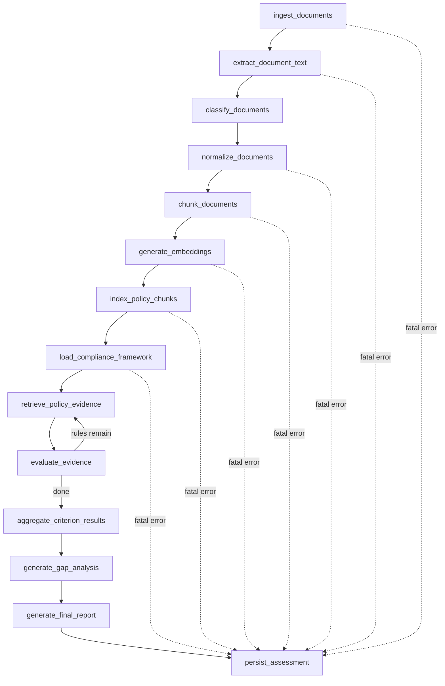
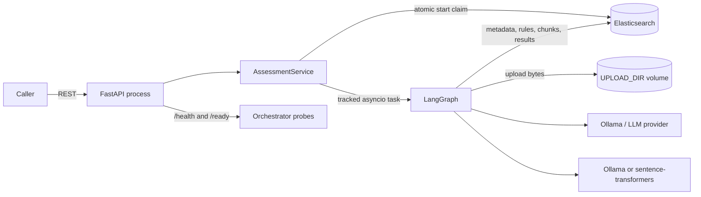

# Architecture — Compliance Evaluator

## Overview

The platform evaluates uploaded PDF and DOCX policies against active,
framework-scoped atomic rules. FastAPI owns the HTTP contract and assessment
lifecycle; LangGraph orchestrates extraction through persistence. Elasticsearch
is the system of record for metadata, chunks, rules, assessments, and results.
Uploaded bytes live in a configured filesystem volume. Ollama provides the
default structured-output LLM and embedding API.

## Pipeline (LangGraph)

- **Typed state** (`ComplianceState` TypedDict) carries documents, extracted
  pages, classified docs, chunks, rules, evidence, evaluations, results,
  errors, and timings between nodes.
- **Conditional edges**: preprocessing fatal errors route to persistence.
  The rule loop repeats retrieval and evaluation until no rule IDs remain.
- **Error capture**: extraction, retrieval, evaluation, and persistence errors
  are recorded in state. A failed retrieval skips that rule's verdict; it is
  not converted into `ABSENT` evidence. Any recorded workflow error makes the
  result `PARTIAL` unless a fatal preprocessing error leaves no results, in
  which case it is `FAILED`.

## Runtime topology

The graph task executes in the API process; it is tracked and drained during
graceful shutdown but is not durable across an ungraceful process loss. The
filesystem volume must be shared and persistent if multiple API replicas are
used. A durable queue/worker and object storage are required for resilient
horizontal scaling.

## Components

### Ingestion
- `storage/local.py` — opaque upload bytes stored below `UPLOAD_DIR` using
  server-generated IDs; resolved paths are checked against the storage root.
- `security/validation.py` — extension, signature, size, and DOCX ZIP
  expansion/member-count limits; filename sanitization; injection-pattern
  identifiers (sensitive matched text is not logged).
- `documents/extraction/pdf.py` — PyMuPDF page-level text + bold-heading
  detection; whitespace-normalized but verbatim-preserving (citations must
  remain exact substrings).
- `documents/extraction/docx.py` — structure-aware .docx extraction: emits
  one logical section per heading (Heading1–6 styles, embedded altChunk
  HTML, or bold-run heuristic for unstyled docs) with `heading_path`
  metadata; tables serialized as atomic blocks. `DocumentExtractor`
  dispatches on extension.
- `documents/classification/classifier.py` — three modes: explicit routing
  (upload-time `document_type`), heuristic (filename + keyword scoring),
  LLM fallback (JSON-only classification below confidence threshold).
- `documents/chunking/chunker.py` — paragraph-aware chunking, never merges
  across pages; carries `document_id/filename/page/section/document_type`
  into every chunk; `content_hash` enables idempotent re-indexing.

### Retrieval
- `embeddings/` — `EmbeddingProvider` protocol; Ollama (`nomic-embed-text`,
  768-d) and optional `sentence-transformers` implementations.
- `retrieval/retriever.py` — hybrid: ES kNN on `dense_vector` + BM25
  `match` on text/section, filtered by `assessment_id` (+ optional
  `document_type`), normalized cosine score threshold, dedup, capped at
  `MAX_EVIDENCE_CHUNKS`. If either search leg fails, retrieval raises an
  operational error rather than presenting partial search as a complete
  corpus miss.

### Evaluation
- `compliance/prompts.py` — system prompt fixes the audit contract; policy
  text is embedded only inside `BEGIN/END_POLICY_EVIDENCE` delimiters marked
  UNTRUSTED. JSON-schema-constrained output via Ollama `format` parameter.
- `compliance/evaluator.py` — builds prompt, parses + validates structured
  output, performs configured output/citation retries, then **enforces
  semantics in code**: `PARTIAL`/`ABSENT`/`CONTRADICTORY` ⇒
  `NOT_COMPLIANT` regardless of model output; `COMPLIANT` requires ≥1 valid
  citation.
- `compliance/citation.py` — each citation must be a verbatim
  (whitespace-tolerant) substring of a retrieved chunk's stored text,
  resolvable by `chunk_id` or `filename+page`. Invalid citations are
  rejected; a `COMPLIANT` verdict with zero valid citations is downgraded.
- `compliance/gap.py` — for each `NOT_COMPLIANT` rule, LLM produces
  gap / missing requirement / recommendation / expected evidence / severity;
  deterministic fallback if the model fails.
- `compliance/aggregation.py` — per-criterion results + assessment summary
  (counts, compliance %, evidence-status breakdown).

### Persistence (Elasticsearch)
Five indices under a configurable prefix:

| Index | Contents |
|---|---|
| `policy_documents` | upload metadata, classification, status |
| `policy_chunks` | chunk text + metadata + `dense_vector` embedding |
| `compliance_rules` | atomic rules (framework, criterion, requirement, keywords) |
| `assessments` | lifecycle status, summary, timings, errors |
| `assessment_results` | per-rule verdict, evidence, citations, gap |

## Prompt-injection defense (defense in depth)

1. **Architectural isolation** — policy text never enters the system prompt;
   it is data inside delimiters.
2. **Instruction hierarchy** — system prompt explicitly forbids following
   instructions found inside evidence.
3. **Heuristic detection** — retrieved evidence text is scanned for known
   injection patterns; only fixed pattern identifiers are logged. Detection is
   observational, not a security boundary.
4. **Semantic enforcement** — verdict rules are applied in Python after the
   LLM responds; the model cannot self-certify compliance.
5. **Citation grounding** — fabricated quotes/documents/pages are rejected
   by verbatim substring verification.

## Verdict semantics

| Evidence status | Verdict |
|---|---|
| `EXPLICIT` + valid citation | `COMPLIANT` |
| `EXPLICIT` w/o valid citation | `NOT_COMPLIANT` (downgraded) |
| `PARTIAL`, `ABSENT`, `CONTRADICTORY` | `NOT_COMPLIANT` |

## Configuration & extensibility

- All settings via env (`app/config/settings.py`, pydantic-settings).
- LLM/embedding providers behind protocols — swap Ollama for another local
  server by implementing `LLMProvider`/`EmbeddingProvider`.
- Rules are data: seed from `fixtures/rules/soc2_demo_rules.json` or import
  from the library-sync composite index via
  `scripts/import_rules_from_library.py`.
- Environment validation rejects invalid chunk sizes, retry counts, dimensions,
  and thresholds before serving requests.
- Framework rule subsets must be active and belong to the assessment's
  framework. Elasticsearch atomically claims a pending assessment to avoid
  duplicate concurrent submissions. Terminal assessments are immutable; create
  a new assessment for a retry or changed rule scope.

## Operational limits and known risks

- `/health` is a liveness check. `/ready` returns 503 unless Elasticsearch,
  the configured LLM model, and the embedding provider are available.
- The API process owns background jobs. A forced kill can leave a status in
  `PROCESSING`; the current design has no lease/heartbeat or startup recovery.
- `UPLOAD_DIR` is local storage, not a portable distributed system of record.
  Persist it between restarts and share it across replicas.
- Image-only PDFs are rejected because OCR is not implemented.
- Authentication, tenant authorization, and customer-level data isolation are
  not implemented; do not expose this demo API to untrusted networks.
